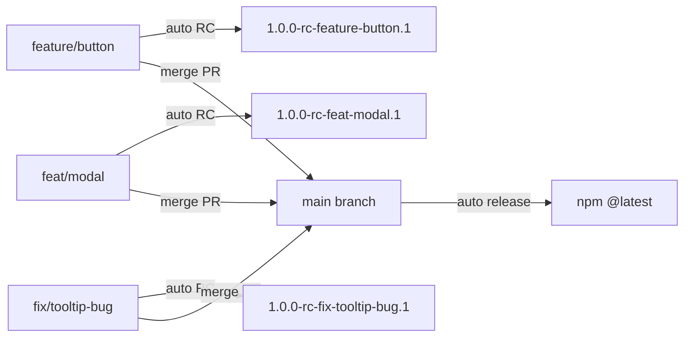

# 🚀 Release Process

This project uses **semantic-release** for fully automated versioning and package publishing. Configuration: [`.releaserc.mjs`](./.releaserc.mjs) (design-system), [`packages/mcp/.releaserc.mjs`](./packages/mcp/.releaserc.mjs), [`packages/migrator/.releaserc.mjs`](./packages/migrator/.releaserc.mjs), all built on the shared [`packages/configs/publishing/releaserc.mjs`](./packages/configs/publishing/releaserc.mjs).

## Branch Strategy



**Feature-to-Production Flow**:

- `feature/*`, `feat/*` and `fix/*` branches automatically create RC versions for testing
- `main` branch creates production versions after PR merge

## Automatic Versioning

Version bumps are determined by commit messages following [Conventional Commits](https://www.conventionalcommits.org/) (`releaseRules` in the shared releaserc). This is the single source of truth for the commit-type → release mapping:

| Commit Type                                                         | Release Type | Version Change    | Example                         |
| ------------------------------------------------------------------- | ------------ | ----------------- | ------------------------------- |
| `fix:`, `perf:`, `revert:`                                          | Patch        | `1.0.0` → `1.0.1` | `fix: correct button alignment` |
| `feat:`                                                             | Minor        | `1.0.0` → `1.1.0` | `feat: add new Modal component` |
| `feat!:` or `BREAKING CHANGE:`                                      | Major        | `1.0.0` → `2.0.0` | `feat!: redesign API structure` |
| `docs:`, `style:`, `refactor:`, `test:`, `build:`, `ci:`, `chore:` | No release   | -                 | `docs: update README`           |

Breaking changes must also ship a migration in `packages/migrator/src/migrations/` (see [CLAUDE.md](./CLAUDE.md)).

## RC Version Format

The prerelease id is `rc-` plus the **full branch name** with `/` and `_` replaced by `-`. The npm dist-tag is the **raw branch name**:

| Branch              | Version                        | npm dist-tag        |
| ------------------- | ------------------------------ | ------------------- |
| `main`              | `1.1.0`                        | `latest`            |
| `feature/button`    | `1.1.0-rc-feature-button.1`    | `feature/button`    |
| `feat/WDS-142_chat` | `1.1.0-rc-feat-WDS-142-chat.1` | `feat/WDS-142_chat` |
| `fix/tooltip-bug`   | `1.0.1-rc-fix-tooltip-bug.1`   | `fix/tooltip-bug`   |

Each further push with a releasable commit increments the last number (`.2`, `.3`, …). Because dist-tags contain `/`, `npm install @wallarm-org/design-system@feature/button` does **not** work (npm treats it as a GitHub repo) — always install the exact version:

```bash
# Find the RC version for your branch
npm view @wallarm-org/design-system dist-tags | grep feature/button
# or list the most recent versions
npm view @wallarm-org/design-system versions --json | tail

# Install it
npm install @wallarm-org/design-system@1.1.0-rc-feature-button.1
```

## Screenshot Updates

### Automatic Screenshot Updates

To update visual regression test screenshots in CI:

1. **Add trigger to commit message**:

   ```bash
   git commit -m "feat: update button styles [update-screenshots]"
   git push
   ```

2. **CI automatically**:
   - Runs tests with `--update-snapshots` flag
   - Commits updated screenshots (`🖼️ Update screenshots`)
   - Pushes changes back to branch

3. **Protection against loops**:
   - The bot commit message does not contain `[update-screenshots]`, so it never re-triggers regeneration
   - A verification E2E run against the new baselines is started via `gh workflow run` (non-`main` branches) or by the deploy-key push itself (`main`)

### Manual Screenshot Updates

For local updates (requires `pnpm storybook` running on the host):

```bash
pnpm e2e:docker:update:design-system
```

## Development Workflow

### 1. Create Feature Branch

```bash
# Always branch from main
git checkout -b feature/awesome-button main
```

### 2. Develop with Conventional Commits

```bash
git commit -m "feat: add new button variant"
git commit -m "fix: resolve hover state issue"
git commit -m "docs: update button examples"
```

### 3. Push to Get RC Version

```bash
git push origin feature/awesome-button

# Automatically creates RC version:
# 1.1.0-rc-feature-awesome-button.1
# Published to npm with dist-tag: feature/awesome-button
```

### 4. Test RC Version

```bash
npm install @wallarm-org/design-system@1.1.0-rc-feature-awesome-button.1
```

### 5. Create Pull Request

PR title must follow conventional commit format (checked by `pr-title.yml`), e.g. `feat: add awesome button component`.

### 6. Production Release (Automatic)

When the PR is merged to `main`, the `release` job in `.github/workflows/main.yml`:

1. Analyzes all commits since the last release
2. Determines version bump (major/minor/patch)
3. Updates `CHANGELOG.md` and commits `chore(release): vX.Y.Z [skip ci]`
4. Publishes to npm with `latest` tag
5. Creates a GitHub release

After a stable design-system release, the `release` job dispatches the separate [`deploy-site.yml`](./.github/workflows/deploy-site.yml) workflow with the new `vX.Y.Z` tag. It builds the docs site and Storybook from that tag and deploys both to GitHub Pages (docs at `/design-system/`, Storybook at `/design-system/storybook/`). The dispatch never blocks the npm releases. To redeploy, roll back or recover from a failed deploy, run `gh workflow run deploy-site.yml --ref main -f tag=vX.Y.Z` (the tag must contain any fix).

## What Happens Automatically

### On push to `feature/*`, `feat/*`, `fix/*`:

1. **Quality Checks** - Runs lint, typecheck, and tests
2. **Build** - Builds all packages
3. **Version Analysis** - Determines next RC version
4. **NPM Publish** - Publishes e.g. `1.1.0-rc-feature-name.1` under the branch-name dist-tag
5. **GitHub Prerelease** - Creates a GitHub prerelease (no CHANGELOG update, no release commit)

### On merge to `main`:

1. **Quality Checks** - Runs lint, typecheck, and tests
2. **Build** - Builds all packages (except the docs site) and Storybook
3. **Version Analysis** - Determines version from commits
4. **Changelog Update** - Updates `CHANGELOG.md` (only on `main`)
5. **NPM Publish** - Publishes with `latest` tag
6. **GitHub Release** - Creates release with notes
7. **Site Deploy** - On a stable design-system release, dispatches `deploy-site.yml`, which deploys the docs site and Storybook to GitHub Pages

`@wallarm-org/mcp` and `@wallarm-org/migrator` are released by the same job only when needed: mcp when `packages/mcp`/`packages/mcp-core` changed or the branch has a breaking change; migrator when `packages/migrator` changed since its last stable tag or the design-system release stamped `packages/migrator/versions.json`. See the job list in [CLAUDE.md](./CLAUDE.md#pipeline-jobs).

## Managing RC Versions

### Clean Up Old RC Versions

RC versions are **not** deprecated automatically. Deprecate manually if needed:

```bash
npm deprecate @wallarm-org/design-system@1.0.0-rc-feat-old-feature.1 "Feature merged to main"
```

### Testing Multiple RCs

```bash
# Use npm aliases to install several RCs side by side
npm install button-rc@npm:@wallarm-org/design-system@1.1.0-rc-feature-button.1
npm install modal-rc@npm:@wallarm-org/design-system@1.1.0-rc-feat-modal.1
```

## Requirements

### Required Secrets

- `NPM_TOKEN`: NPM automation token, used by the `release` job to publish `@wallarm-org/design-system`, `@wallarm-org/mcp` and `@wallarm-org/migrator` (it must be allowed to create new packages under `@wallarm-org` for a package's first publish)
- `DEPLOY_KEY`: Private half of a write deploy key. `main` is guarded by repository rulesets that `GITHUB_TOKEN` cannot bypass (see Branch Rules), so the `release` job (semantic-release, over SSH via `repositoryUrl` in `packages/configs/publishing/releaserc.mjs`) and `commit-screenshots` (on `main` only) push with this key
- `FIGMA_ACCESS_TOKEN`: Figma personal access token (scopes: File content read, Code Connect write), used by `publish-code-connect`
- `GITHUB_TOKEN`: Automatically provided by GitHub Actions

### Branch Rules

`main` has two repository rulesets (Settings → Rules → Rulesets; they live in GitHub, not in this repo):

- **`main: only admins merge`** — restricts updates, deletion and force pushes. Repo admins (exempt) and deploy keys bypass it.
- **`main: required checks`** — requires the `Require migration for breaking changes` check (`require-migration` in `pr-title.yml`). Only deploy keys bypass it, so `release` and `commit-screenshots` keep pushing; admins merging a PR are blocked while the check fails. A separate ruleset is needed because admins are exempt from the first one.

To recreate the second ruleset:

```bash
gh api repos/wallarm/design-system/rulesets --method POST --input - <<'EOF'
{
  "name": "main: required checks",
  "target": "branch",
  "enforcement": "active",
  "conditions": { "ref_name": { "include": ["~DEFAULT_BRANCH"], "exclude": [] } },
  "bypass_actors": [{ "actor_type": "DeployKey", "bypass_mode": "always" }],
  "rules": [
    {
      "type": "required_status_checks",
      "parameters": {
        "strict_required_status_checks_policy": false,
        "do_not_enforce_on_create": false,
        "required_status_checks": [
          { "context": "Require migration for breaking changes", "integration_id": 15368 }
        ]
      }
    }
  ]
}
EOF
```

`integration_id` 15368 is GitHub Actions. The check only runs on `pull_request`, so a direct (non-PR) push to `main` by anyone but a deploy key is rejected by this ruleset.

### Workflow

Quality checks, build, E2E, screenshot updates, and the release itself run as jobs inside [`main.yml`](./.github/workflows/main.yml), triggered on push to any branch. PR title validation is a separate workflow, [`pr-title.yml`](./.github/workflows/pr-title.yml). The GitHub Pages deploy (docs site and Storybook) is [`deploy-site.yml`](./.github/workflows/deploy-site.yml), dispatched by `release` after a stable release. The full job list is in [CLAUDE.md](./CLAUDE.md#pipeline-jobs).

### Naming Conventions

- Branches: `feature/*`, `feat/*` or `fix/*` — anything else gets no RC
- Use hyphens (Jira keys stay uppercase); the whole branch name ends up in the RC version
- Examples:
  - ✅ `feature/dark-mode`
  - ✅ `fix/tooltip-positioning`
  - ✅ `feat/WDS-142-wally-ai-assistant`
  - ❌ `myfeature`

## Troubleshooting

### RC Version Not Created

- Verify branch name starts with `feature/`, `feat/` or `fix/`
- Verify the branch has a releasable commit (`feat`, `fix`, `perf`, `revert` or breaking)
- Check the `release` job in GitHub Actions for errors

### Can't Install RC Version

- Install by exact version, not by dist-tag (see [RC Version Format](#rc-version-format))
- Look it up: `npm view @wallarm-org/design-system dist-tags`

### No Version Bump on `main`

- Run `pnpm semantic-release:dry-run` to see what semantic-release would release and why
